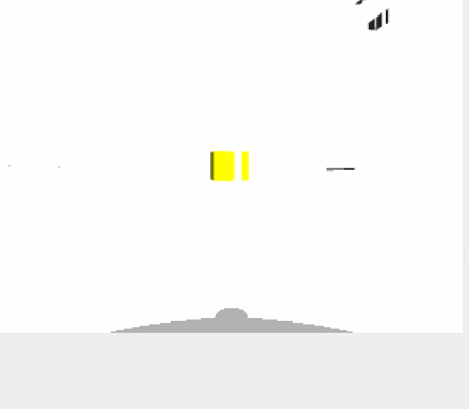
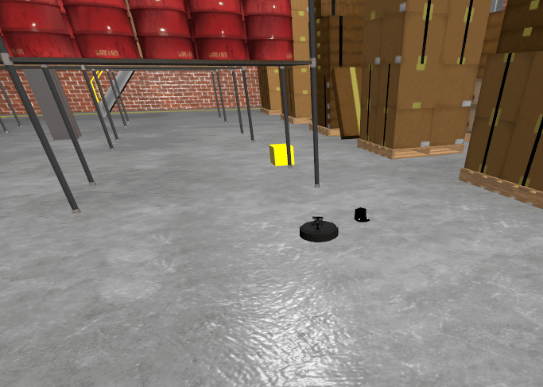

# Autonomous Mobile Robot Patrol & RGB-D 3D Object Detection

A ROS 2 and Nav2 autonomous navigation project featuring a **TurtleBot 4 Lite** in a simulated warehouse environment (`depot`). The robot continuously patrols a bidirectional route of user-defined waypoints while using its onboard **OAK-D RGB-D camera** to detect yellow target objects in real time. When an object is spotted, its 2D image centroid is back-projected into 3D space using synchronized depth measurements, transformed into the global `map` frame via `tf2`, and used to compute a safe standoff approach pose before resuming the patrol route.

---

## Demonstrations

| Onboard Camera View (Object Detection) | Top-Down Approach View (Gazebo / RViz2) |
| :---: | :---: |
|  |  |
---

## Overview & Key Features

* **Synchronized RGB-D 3D Back-Projection:** Uses `message_filters.ApproximateTimeSynchronizer` to pair RGB frames (`/oakd/rgb/preview/image_raw`) and depth maps (`/oakd/rgb/preview/depth`), extracting 2D object centroids in HSV color space and projecting them into 3D camera coordinates using intrinsic camera parameters.
* **Global Frame Transformation (`tf2`):** Automatically transforms 3D object centroids from the optical camera frame into the global `map` frame (`/yellow_object_point`) for seamless integration with the Nav2 stack.
* **Dynamic Patrol Interruption & Standoff Navigation:** Implements a Finite State Machine (`PATROLLING` $\rightarrow$ `CANCELING_PATROL` $\rightarrow$ `APPROACHING_OBJECT` $\rightarrow$ `WAITING_AT_OBJECT`) via the `nav2_simple_commander` API (`BasicNavigator`).
* **Interactive Waypoint Logging:** Includes a utility node (`click_logger.py`) that records points clicked directly in RViz2 (`/clicked_point`) and serializes them to a YAML configuration file (`clicked_points.yaml`) to construct a continuous forward-and-backward patrol loop.
* **Duplicate Object Filtering:** Tracks visited object coordinates in the `map` frame to ensure each detected yellow object is inspected once without triggering repetitive approach loops.

---

## System Architecture

### 1. `yellow_object_detector.py` (`YellowObjectDetector`)
Performs real-time visual segmentation and 3D localization:
* Subscribes to `/oakd/rgb/preview/camera_info` to extract camera intrinsics $(f_x, f_y, c_x, c_y)$.
* Synchronizes `/oakd/rgb/preview/image_raw` and `/oakd/rgb/preview/depth` within a $0.05\text{ s}$ tolerance window.
* Converts RGB images to HSV color space and applies a color threshold (`[20, 100, 100]` to `[35, 255, 255]`) to isolate yellow objects.
* Uses connected-component analysis (`cv2.connectedComponentsWithStats`) to find the largest valid contour ($\text{area} > 200\text{ px}^2$) and its pixel centroid $(u, v)$.
* Reads the depth $z$ at pixel $(u, v)$ and back-projects the centroid into 3D camera coordinates using the pinhole camera model.
* Transforms $(x_{\text{cam}}, y_{\text{cam}}, z_{\text{cam}})$ into the global `map` frame via `tf2_ros` and publishes the result to `/yellow_object_point` (`geometry_msgs/msg/Point`).

### 2. `waypoint_follower.py` (`WaypointFollower`)
Manages autonomous waypoint patrolling and object inspection:
* Loads 2D waypoints from `config/clicked_points.yaml` and constructs a palindromic patrol sequence (forward + reverse traversal).
* Monitors the robot's global pose via `/amcl_pose` and listens for newly detected objects on `/yellow_object_point`.
* Computes a safe standoff pose $d_{\text{safe}} = 0.6\text{ m}$ in front of the detected object along the line-of-sight vector from the robot $(x_r, y_r)$ to the object $(x_o, y_o)$.

| State | Behavior |
| :--- | :--- |
| **`PATROLLING`** | Executes `followWaypoints()` along the bidirectional patrol path. | 
| **`CANCELING_PATROL`** | Waits for the active Nav2 waypoint task cancellation to complete cleanly. | 
| **`APPROACHING_OBJECT`** | Navigates to the $0.6\text{ m}$ standoff pose facing the center of the yellow object. |
| **`WAITING_AT_OBJECT`** | Holds position facing the object for a $3.0\text{ s}$ inspection duration. | 

### 3. `click_logger.py` (`ClickLogger`)
Interactive waypoint recording utility:
* Subscribes to `/clicked_point` (`geometry_msgs/msg/PointStamped`) from the RViz2 **"Publish Point"** tool.
* Records up to `max_points` (default: `5`) and automatically writes them to `config/clicked_points.yaml`.

### 4. Launch Files (`all_systems.launch.py` & `spawn_objects.launch.py`)
* Launches the Gazebo `depot` simulation with the TurtleBot 4 Lite, opens the RViz2 navigation view after a $5.0\text{ s}$ timer, and spawns the yellow target boxes (`yellow_box.sdf`) into the world after $15.0\text{ s}$.

---

## Usage

Build the workspace and source the environment:

```bash
colcon build --symlink-install
source install/setup.bash
```

Run the following commands in separate terminals (ensuring `source install/setup.bash` is sourced in each):

### 1. Launch Gazebo Simulation, RViz2 & Spawn Yellow Objects
Starts the TurtleBot 4 Gazebo simulation, launches RViz2, and spawns the yellow objects:

```bash
ros2 launch rob_patroller all_systems.launch.py
```

### 2. Launch Localization (AMCL)
Loads the pre-built map (`maps.yaml`) and starts localization:

```bash
ros2 launch turtlebot4_navigation localization.launch.py map:=/path/to/rob_patroller/src/maps/maps.yaml
```

### 3. Launch the Nav2 Navigation Stack
Starts the Nav2 servers with simulation time enabled:

```bash
ros2 launch turtlebot4_navigation nav2.launch.py use_sim_time:=true
```

### 4. (Optional) Record New Patrol Waypoints
If you want to overwrite the existing patrol waypoints in `config/clicked_points.yaml`, run the click logger and select 5 points in RViz2 using the **Publish Point** tool:

```bash
ros2 run rob_patroller click_logger.py
```

### 5. Start the RGB-D Yellow Object Detector
Starts the HSV segmentation and 3D depth back-projection node:

```bash
ros2 run rob_patroller yellow_object_detector
```

### 6. Start the Autonomous Waypoint Follower
Starts the patrol loop and dynamic object approach state machine:

```bash
ros2 run rob_patroller waypoint_follower
```

---

## Configurable Parameters & Constants

| Node | Parameter / Attribute | Default | Description |
| :--- | :--- | :--- | :--- |
| `click_logger` | `max_points` | `5` | Number of clicked RViz2 points to record before saving to YAML |
| `yellow_object_detector` | `lower_yellow` / `upper_yellow` | `[20, 100, 100]` / `[35, 255, 255]` | HSV color bounds for yellow object segmentation |
| `yellow_object_detector` | `min_area` | `200` | Minimum connected-component pixel area required for valid detection |
| `waypoint_follower` | `safe_distance` | `0.6` | Standoff distance (m) from the detected object's 3D center |
| `waypoint_follower` | `wait_time_at_object` | `3.0` | Duration (s) the robot waits while inspecting a detected object |